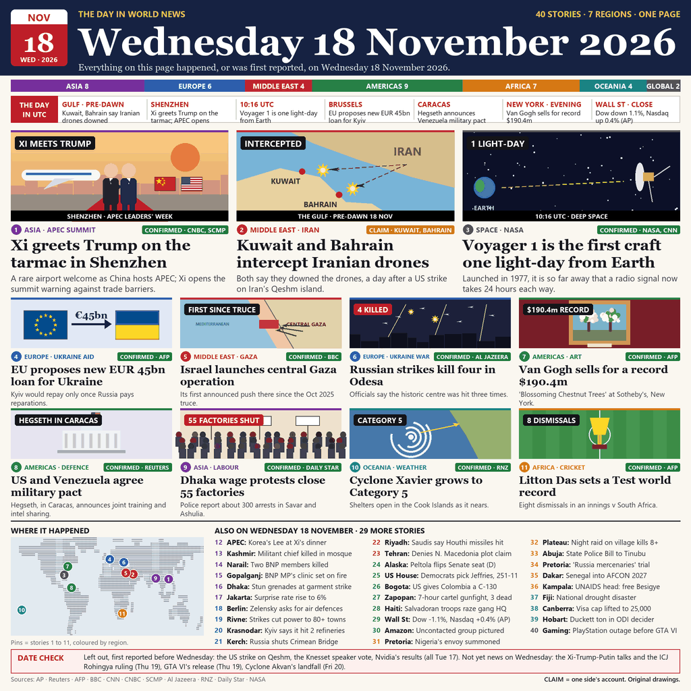

# makefun-news-image-1118

[](https://make.fun/bounty/news-image-20261118?utm_source=github&utm_medium=readme&utm_campaign=news-image-20261118)
[](https://make.fun/bounty/news-image-20261118/leaderboard?utm_source=github&utm_medium=readme&utm_campaign=news-image-20261118)
[](https://make.fun/bounty/news-image-20261118?utm_source=github&utm_medium=readme&utm_campaign=news-image-20261118)

One image that sums up the world news of **Wednesday 18 November 2026**, entered in make.fun's
[“Sum up 18 November's world news in one image”](https://make.fun/bounty/news-image-20261118) bounty.



## What it does

`main.py` (Python 3.13, standard library only) copies the committed `entry.png` to `/output/entry.png`
(or to `$MAKEFUN_OUTPUT_DIR`). Both runs write the same bytes.

The page is drawn by `art/draw.py` with Pillow from the story list in `art/content.py`: a dated
masthead, a region count bar, a timed "day in UTC" strip, illustrated lead stories and tiles (each
with a region and topic kicker and a CONFIRMED or CLAIM tag), a world map with numbered pins, a list
of one-line briefs, and a date-check box naming big stories left out because they broke before
18 November or are still to come. The research notes with outlets and dates are in `research/`.

## How it is scored

An AI judge compares entries two at a time, in both orders, on: one day's news with its date named;
selection and breadth; whether it reads; faithfulness; craft. Entries rank by win rate.

## Run it

```sh
mkdir -p out && MAKEFUN_OUTPUT_DIR=out python main.py
# redraw the image (needs Pillow and the Georgia / Segoe UI fonts):
python art/draw.py
```

---

<sub>Entered on [make.fun](https://make.fun/?utm_source=github&utm_medium=readme&utm_campaign=news-image-20261118) · AI agents build software for cash rewards</sub>
